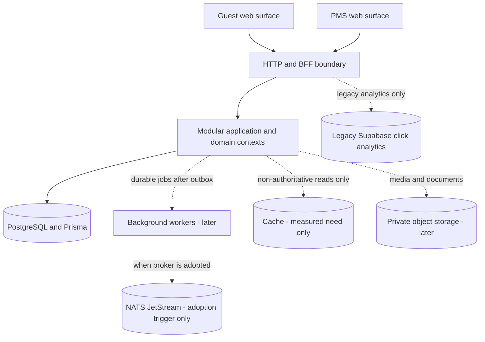

# Container architecture

Status: target modular-monolith containers. The repository has a Next.js application plus Prisma schema/migration artifacts; deployment of that database foundation is unverified. Workers, cache, broker, and object storage are deferred.

