# Data ownership

Status: target ownership. The repository contains schema/migration artifacts only for tenant/domain/membership/RBAC plus a separate legacy click-analytics schema; applied database state is unverified.

```mermaid
flowchart TB
  identity["Identity & Access"] --> identityData[(staff_memberships, roles, permissions, membership_property_scopes)]
  organization["Organization & Tenancy"] --> organizationData[(tenants, tenant_domains, organization_settings)]
  property[Property] --> propertyData[(properties, addresses, room_types, units, amenities, media metadata)]
  inventory[Inventory] --> inventoryData[(inventory_pools, inventory_days, allocations, holds, unit_assignments, blocks)]
  pricing[Pricing] --> pricingData[(rate_plans, rates, restrictions, pricing_rules, quotes)]
  reservation[Reservation] --> reservationData[(reservations, items, guest links, state history, confirmed price snapshots)]
  guest[Guest] --> guestData[(guest_profiles, contacts, identity records, consents)]
  payment[Payment] --> paymentData[(payment_intents, provider_events, payment_transactions, refunds)]
  finance[Finance] --> financeData[(guest_invoices, ledger postings, settlements, fees, payouts, expenses)]
  operations[Operations] --> operationsData[(stays, guest_stays, housekeeping, maintenance, unit readiness)]
  notification[Notification] --> notificationData[(templates, notifications, delivery attempts, preferences)]
  search[Search] --> searchData[(property search projections, indexing checkpoints)]
  review[Review] --> reviewData[(eligibilities, reviews, moderation, rating projections)]
  promotion[Promotion] --> promotionData[(promotions, coupons, rules, redemptions)]
  distribution["Distribution / Channel Manager"] --> distributionData[(channel accounts, mappings, external refs, sync runs, conflicts)]
  analytics[Analytics] --> analyticsData[(ingestion checkpoints, facts, metric aggregates)]
  audit[Audit] --> auditData[(audit_events, retention and export checkpoints)]
  billing[Platform Billing] --> billingData[(plans, subscriptions, subscription invoices and payments, entitlements)]
```

